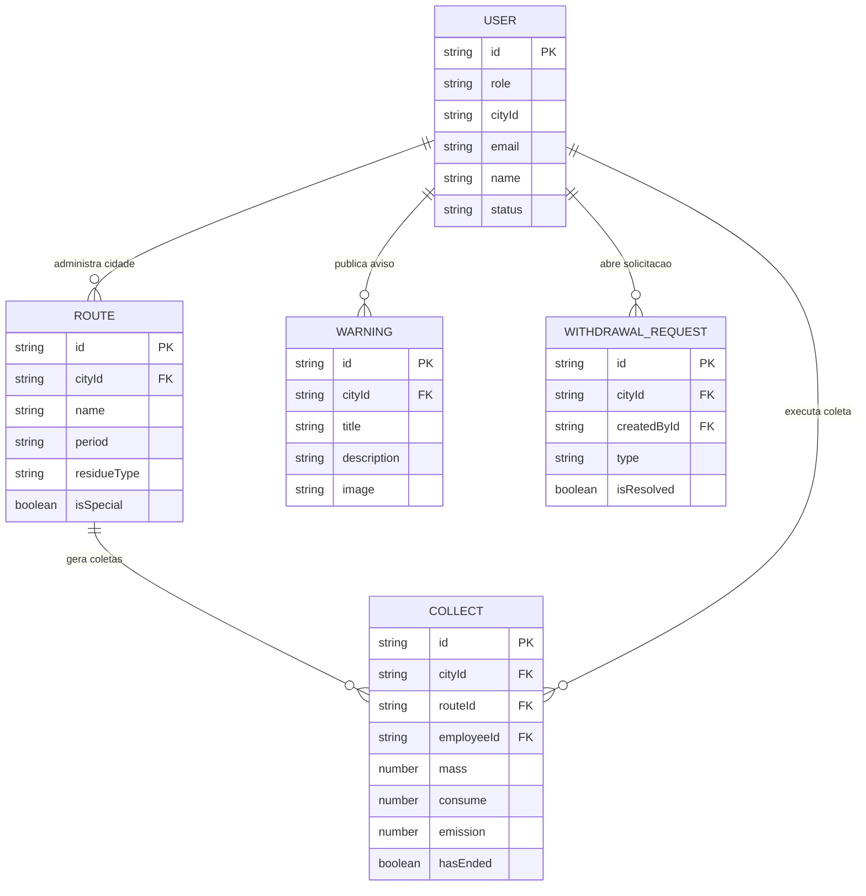

# Architecture — coletare-new-back

## Visão arquitetural

- 🟢 **CONFIRMADO** Arquitetura em camadas no front-end/server híbrido do Next.js App Router.
- 🟢 **CONFIRMADO** `src/app` concentra páginas e endpoints internos (`/api/*`).
- 🟢 **CONFIRMADO** `src/store/services` centraliza integrações e acesso a dados.
- 🟢 **CONFIRMADO** `src/hooks/queries` padroniza leitura de dados com React Query.

## Containers principais

1. 🟢 **CONFIRMADO** **Web App (Next.js 14)**
   - UI autenticada e pública
   - Endpoints server-side (`createAuth`, `deleteAuth`, `email`, `notifications`)
2. 🟢 **CONFIRMADO** **Firebase Auth**
   - Login e ciclo de vida de credenciais
3. 🟢 **CONFIRMADO** **Firebase Realtime DB / Firestore**
   - Persistência de usuários, rotas, coletas, avisos e solicitações
4. 🟢 **CONFIRMADO** **Firebase Storage**
   - Mídias de municípios e avisos
5. 🟢 **CONFIRMADO** **Serviços externos**
   - Google Maps, Expo Push, SMTP e API de Ecopontos

## ERD resumido (essencial)

## Integrações e contratos

- 🟢 **CONFIRMADO** API interna `/api/email` para envio de email.
- 🟢 **CONFIRMADO** API interna `/api/notifications` para push notifications com lógica de proximidade.
- 🟢 **CONFIRMADO** API interna `/api/createAuth` e `/api/deleteAuth` para operações administrativas de conta.
- 🟢 **CONFIRMADO** API externa de ecopontos via `NEXT_PUBLIC_API_ECOTOOLS_URL`.

## Dívidas técnicas e riscos

- 🟡 **INFERIDO** Forte acoplamento da lógica de domínio com Firebase dificulta substituição de backend.
- 🟢 **CONFIRMADO** Cobertura de testes automatizados limitada (predomínio de teste de carga isolado).
- 🟡 **INFERIDO** Regras de autorização espalhadas por telas e componentes, com risco de inconsistência.
- 🔴 **LACUNA** Ausência de ADRs formais no repositório para decisões arquiteturais críticas.

## Referência C4

- Diagrama de contexto: [_reversa_sdd/c4-context.md](_reversa_sdd/c4-context.md)
