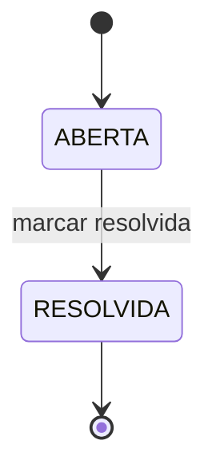
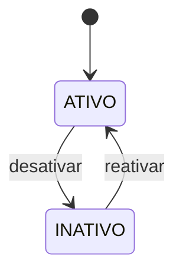
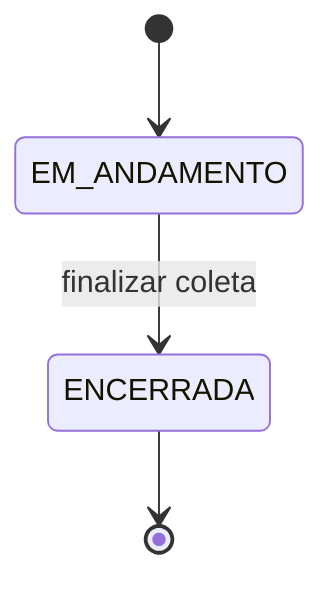

# State Machines — coletare-new-back

## 1) Solicitação de retirada (`WithdrawalsRequestEntity`)

- 🟢 **CONFIRMADO** Campo de estado principal: `isResolved: boolean`
- 🟢 **CONFIRMADO** Estados observáveis:
  - `ABERTA` (`isResolved = false`)
  - `RESOLVIDA` (`isResolved = true`)

### Transições

- 🟢 **CONFIRMADO** `ABERTA -> RESOLVIDA` por ação operacional de resolução.
- 🟡 **INFERIDO** `RESOLVIDA -> ABERTA` não é fluxo padrão e não foi confirmado no código analisado.

## 2) Usuário (`UserEntity`) — status operacional

- 🟢 **CONFIRMADO** Campo opcional: `status?: string`
- 🟢 **CONFIRMADO** Valores usados em telas de município: `Ativo`, `Inativo`

### Transições

- 🟢 **CONFIRMADO** `ATIVO <-> INATIVO` por edição de município.
- 🟡 **INFERIDO** Outros valores de `status` não foram encontrados na amostra analisada.

## 3) Coleta (`CollectEntity`) — conclusão

- 🟢 **CONFIRMADO** Campo de controle: `hasEnded: boolean`
- 🟢 **CONFIRMADO** Estados observáveis:
  - `EM_ANDAMENTO` (`hasEnded = false`)
  - `ENCERRADA` (`hasEnded = true`)

### Transições

- 🟢 **CONFIRMADO** `EM_ANDAMENTO -> ENCERRADA` quando finalizada a coleta.
- 🔴 **LACUNA** Não foi confirmado no código visível se há rollback de `ENCERRADA` para `EM_ANDAMENTO`.

